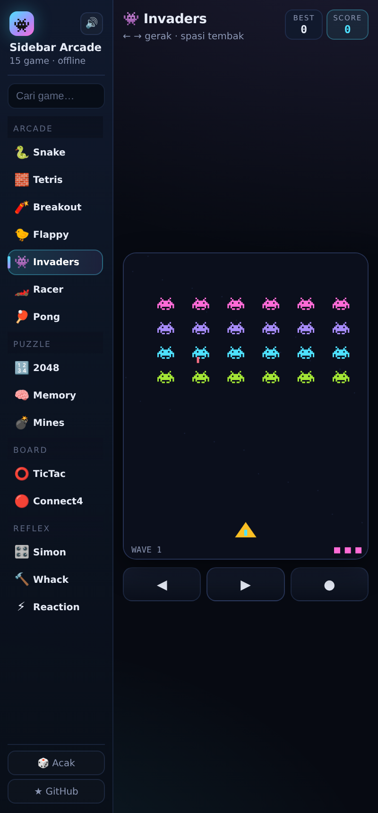
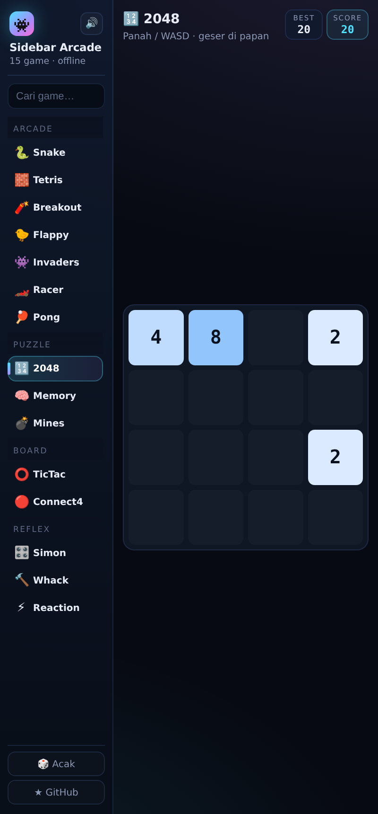

# Sidebar Arcade 👾

**15 game mini di Chrome Side Panel.** Klik ikon extension, panel samping terbuka, pilih game, langsung main. Tanpa akun, tanpa iklan, tanpa koneksi internet.

[](LICENSE)
[](https://developer.chrome.com/docs/extensions/reference/api/sidePanel)
[](#struktur-project)



Dibuat buat nemenin nungguin agent kerja (atau deploy, atau build, atau apapun). Panel-nya sempit, tabnya ke bawah, jadi nggak ganggu tab yang lagi kebuka.

---

## Kenapa dibuat

Nunggu proses panjang itu membosankan. Daripada buka tab game yang penuh iklan, mending satu panel kecil di samping: 15 game, jalan offline, skor tersimpan lokal, dan nggak perlu pindah tab.

## Fitur

- **Side panel, bukan popup** — panel tetap terbuka sambil kamu kerja di tab lain.
- **Tab game vertikal** di sidebar, dikelompokkan: Arcade, Puzzle, Board, Reflex.
- **Semua game langsung bisa dipilih** — nggak ada halaman loading, nggak ada redirect.
- **Skor terbaik disimpan** per game (`chrome.storage.local`), ada juga trophy kecil di tab.
- **Suara 8-bit** (bisa dimatikan), toggle tersimpan.
- **Keyboard + sentuh** — panah/WASD, tap, swipe, dan tombol pad di bawah canvas.
- **Pencarian game** + tombol 🎲 Acak.
- **100% offline**, nol request jaringan, nol tracking.
- **Vanilla JS** tanpa build step. Clone → load unpacked → jalan.

## Daftar game

| # | Game | Kategori | Kontrol |
|---|------|----------|---------|
| 1 | 🐍 Snake | Arcade | Panah / WASD / swipe |
| 2 | 🧱 Tetris | Arcade | ← → · ↑ putar · spasi drop |
| 3 | 🧨 Breakout | Arcade | Panah / sentuh paddle |
| 4 | 🐤 Flappy | Arcade | Klik / spasi / tap |
| 5 | 👾 Invaders | Arcade | ← → · spasi tembak |
| 6 | 🏎️ Neon Racer | Arcade | ← → pindah lajur |
| 7 | 🏓 Pong | Arcade | Panah / sentuh paddle |
| 8 | 🔢 2048 | Puzzle | Panah / WASD / swipe |
| 9 | 🧠 Memory Match | Puzzle | Klik kartu |
| 10 | 💣 Minesweeper | Puzzle | Klik · klik kanan/tahan = 🚩 |
| 11 | ⭕ Tic Tac Toe | Board | Klik kotak (AI minimax) |
| 12 | 🔴 Connect 4 | Board | Klik kolom (AI minimax) |
| 13 | 🎛️ Simon | Reflex | Klik pad sesuai urutan |
| 14 | 🔨 Whack-a-Mole | Reflex | Klik tikus (30 detik) |
| 15 | ⚡ Reaction | Reflex | Klik saat hijau (skor = ms) |

<table>
  <tr>
    <td></td>
    <td></td>
  </tr>
</table>

## Instalasi (Load unpacked)

1. Download repo ini (Code → Download ZIP) lalu extract, atau:
   ```bash
   git clone https://github.com/aisac-id/sidebar-arcade.git
   ```
2. Buka `chrome://extensions`
3. Nyalakan **Developer mode** (kanan atas).
4. Klik **Load unpacked**, pilih folder `sidebar-arcade`.
5. Klik ikon **Sidebar Arcade** di toolbar → side panel terbuka di kanan.

> Butuh **Chrome 116+** (Side Panel API). Jalan juga di Edge/Brave/Arc versi baru.

### Soal lebar 1/4 layar

Chrome nggak menyediakan API untuk memaksa lebar side panel — lebarnya diatur user. UI extension ini memang **dirancang untuk panel sempit (~320–420 px)**, jadi begitu panel dibuka tinggal **drag garis pemisah panel** sampai kira-kira **1/4 lebar layar** (misal 360 px di monitor 1440 px). Ukurannya mengikuti, nggak ada layout yang pecah dari 320 px sampai panel lebar.

Tip: klik kanan ikon extension → **Open side panel** juga bisa. Mau selalu di kanan? Chrome mengingat posisi terakhir.

## Cara pakai

- **Pilih game** di daftar kiri (vertikal, dikelompokkan per kategori).
- **Cari** dengan kotak "Cari game…", atau tekan **🎲 Acak** kalau bingung.
- Skor terbaik tiap game muncul di chip **BEST** dan di bawah nama game pada tab.
- **🔊** untuk mute/unmute. Game terakhir yang dibuka otomatis kebuka lagi saat panel dibuka.
- Game over → tombol **Main lagi** (atau `Enter`/`Spasi` di beberapa game).

## Struktur project

```
sidebar-arcade/
├── manifest.json          # MV3, side_panel + storage
├── background.js          # service worker: buka panel saat ikon diklik
├── sidepanel.html         # shell: sidebar vertikal + area game
├── icons/                 # ikon 16/32/48/128 (+ master 512)
├── docs/                  # screenshot untuk README
└── src/
    ├── app.js             # routing tab, simpan skor, sound, pencarian
    ├── registry.js        # daftar game (urutan tampil)
    ├── styles.css         # desain panel sempit
    ├── lib/
    │   ├── kit.js         # helper DOM, stage canvas, input, sfx, best score
    │   └── store.js       # chrome.storage.local + fallback localStorage
    └── games/
        ├── snake.js  tetris.js  2048.js  breakout.js
        ├── flappy.js invaders.js dodge.js pong.js
        ├── memory.js mines.js   tictactoe.js connect4.js
        └── simon.js  whack.js   reaction.js
```

## Menambah game baru

Setiap game adalah satu file ES module dengan kontrak sederhana:

```js
import { createStage, COLORS, sfx } from "../lib/kit.js";

export default {
  id: "gameku",           // unik, dipakai untuk simpan skor
  name: "Game Ku",        // label di tab (pendek, ~10 karakter)
  emoji: "🕹️",
  tag: "Arcade",          // Arcade | Puzzle | Board | Reflex
  desc: "Deskripsi singkat.",
  bestMode: "max",        // "max" atau "min" (mis. reaction time)

  mount(ctx) {
    const st = createStage(ctx.root, {
      w: 320, h: 400,
      title: "🕹️ Game Ku",
      subtitle: "Panah untuk gerak",
      best: ctx.best,
    });

    st.loop((dt) => { /* update + gambar tiap frame */ });
    st.onKeyDown((key) => sfx("click"));
    st.onTap(() => {});
    st.onSwipe((dir) => {});

    // saat selesai:
    // st.end({ score: 123, sub: "Skor 123", retry: start });
    // ctx.report(123);  ← simpan rekor

    return { destroy: st.destroy };
  },
};
```

Lalu daftarkan di `src/registry.js`:

```js
import gameku from "./games/gameku.js";
export const GAMES = [/* ... */, gameku];
```

Untuk game berbasis DOM (kartu/papan) pakai `createScreen` — lihat `games/memory.js` atau `games/mines.js` sebagai contoh. `ctx.report(score)` dipanggil sekali saat ronde selesai untuk menyimpan rekor.

## Privasi

Extension ini tidak punya akses ke halaman web, tidak mengirim data ke mana pun, dan tidak memakai analytics. Yang disimpan hanya di `chrome.storage.local` kamu: skor terbaik, game terakhir, dan preferensi suara.

Permission yang diminta:
- `sidePanel` — membuka UI di side panel.
- `storage` — menyimpan skor & preferensi.

## Kontribusi

PR game baru sangat welcome. Aturan mainnya cuma:

1. Satu game = satu file di `src/games/`, daftarkan di `registry.js`.
2. Tanpa dependency eksternal, tanpa request jaringan, tanpa `innerHTML` dari input user.
3. Harus enak dimainkan di lebar 320 px dan bisa pakai keyboard **dan** sentuh.
4. Ikuti gaya kode yang ada (vanilla JS, ES modules, komentar seperlunya).

## Lisensi

[MIT](LICENSE) — bebas dipakai, diubah, dan dibagikan.
