<p align="center">
  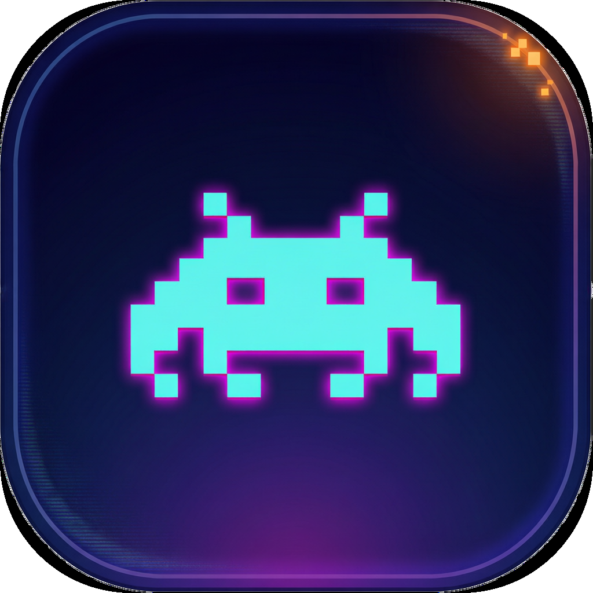
</p>

# Sidebar Arcade 👾

<p align="center">
  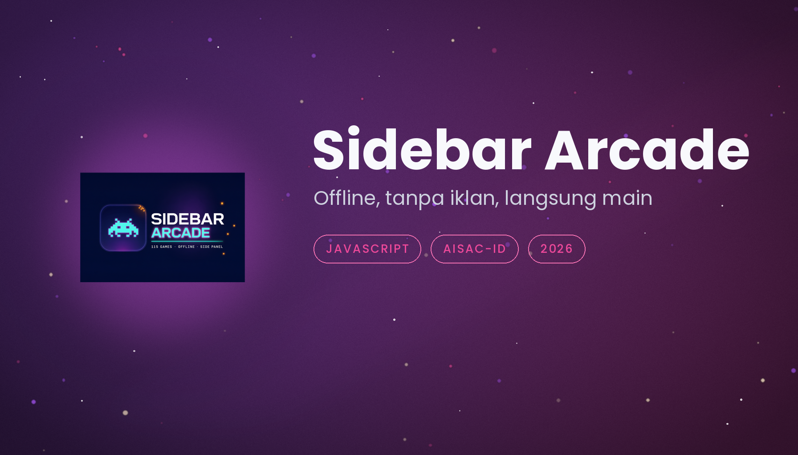
</p>


**115 game mini di Chrome Side Panel.** Klik ikon extension, panel samping terbuka, pilih game, langsung main. Tanpa akun, tanpa iklan, tanpa koneksi internet.

[](LICENSE)
[](https://developer.chrome.com/docs/extensions/reference/api/sidePanel)
[](#struktur-project)
[](#daftar-game)

[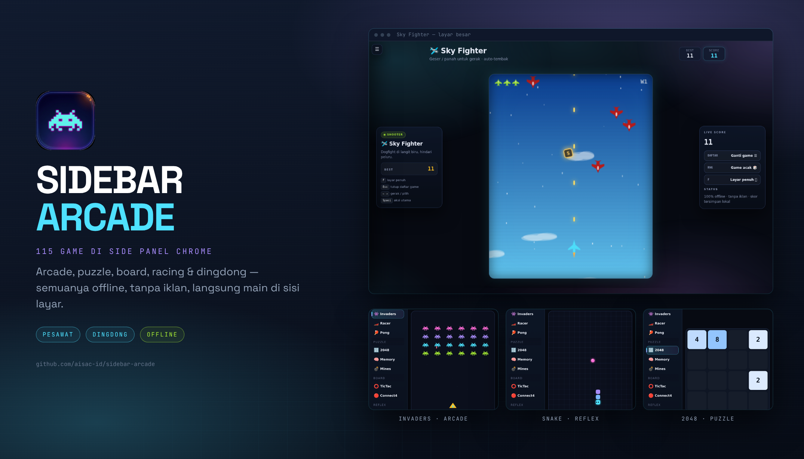](promo/sidebar-arcade-promo.mp4)

<p align="center"><em>▶︎ <a href="promo/sidebar-arcade-promo.mp4">Tonton video promo (8 detik, 1080p)</a></em></p>

Dibuat buat nemenin nungguin agent kerja (atau deploy, atau build, atau apapun). Panel-nya sempit, tabnya ke bawah, jadi nggak ganggu tab yang lagi kebuka.

---

## Kenapa dibuat

Nunggu proses panjang itu membosankan. Daripada buka tab game yang penuh iklan, mending satu panel kecil di samping: 115 game, jalan offline, skor tersimpan lokal, dan nggak perlu pindah tab.

## Fitur

- **Side panel, bukan popup** — panel tetap terbuka sambil kamu kerja di tab lain.
- **Mode layar besar / fullscreen** — tombol ↗ membuka game yang sama di tab baru dengan tata letak kabinet arcade, lalu ▣ (atau tekan `F`) untuk fullscreen.
- **Tab game vertikal** di sidebar, dikelompokkan: Arcade, Shooter, Racing, Puzzle, Word, Board, Luck, Reflex, Skill.
- **115 game langsung bisa dipilih** — nggak ada halaman loading, nggak ada redirect.
- **Mekanik per genre**: nitro + bonus nyaris kena di game balap, dash penghancur rintangan di runner, bola ganda & combo di brick, fase murka boss + shield/bomb di shooter.
- **Ada pesawat-pesawatan**: Space Ace, Sky Fighter, Galaxy Run, Asteroid Storm, Boss Rush, Drone Swarm, UFO Invasion, Neon Shooter, Helicopter Strike, Air Patrol, Missile Command, Space Fortress, Plane Dodger, Jetpack Run, Cave Flyer, Helicopter Cave.
- **Dingdong & kartu**: Slot Machine, Fruit Slot, Lucky Seven, Roulette, Plinko, Spin Wheel, Keno, Scratch Card, Bingo, Blackjack, Video Poker, Yahtzee, Farkle.
- **Skor terbaik disimpan** per game (`chrome.storage.local`), ada juga trophy kecil di tab.
- **Suara 8-bit** (bisa dimatikan), toggle tersimpan.
- **Keyboard + sentuh** — panah/WASD, tap, swipe, drag, dan tombol pad di bawah canvas.
- **Rasa "AAA"** — partikel, screen shake, flash, hitstop, combo multiplier, slow-mo saat kena, dan transisi overlay. Semua jalan di canvas 2D tanpa dependency.
- **Pencarian game** + tombol 🎲 Acak.
- **100% offline**, nol request jaringan, nol tracking.
- **Vanilla JS** tanpa build step. Clone → load unpacked → jalan.

## Daftar game

### Arcade, Shooter & Racing (40)

| Game | Kontrol |
|------|---------|
| 🐍 Snake | Panah / WASD / swipe |
| 🧱 Tetris | ← → · ↑ putar · spasi drop |
| 🧨 Breakout | Panah / sentuh paddle |
| 🐤 Flappy | Klik / spasi / tap |
| 👾 Invaders | ← → · spasi tembak |
| 🏎️ Neon Racer | ← → pindah lajur |
| 🏓 Pong | Panah / sentuh paddle |
| 🚀 Space Ace | Gerak + auto-tembak |
| ✈️ Sky Fighter | Panah / WASD · tembak |
| 🌌 Galaxy Run | Gerak + tembak |
| ☄️ Asteroid Storm | Putar + tembak batu |
| 👹 Boss Rush | Dodge + tembak boss |
| 🛸 Drone Swarm | Tembak drone |
| 👽 UFO Invasion | Tembak UFO |
| 🔫 Neon Shooter | Panah + tembak |
| 🚁 Helicopter Strike | Terbang + bombardir |
| 🛩️ Air Patrol | Pesawat patroli |
| 🚀 Missile Command | Tap kota yang diserang |
| 🛰️ Space Fortress | Bertahan dari gelombang |
| 🛣️ Highway Racer | ← → pindah lajur |
| 🏍️ Bike Lane | Dodge kendaraan |
| 🚂 Train Dodge | Hindari kereta |
| ✈️ Plane Dodger | Hindari pesawat lain |
| 🌃 Night Drive | Nyetir malam |
| 🚚 Truck Traffic | Salip truk |
| 🚤 Boat Rapids | Arungi jeram |
| 🏜️ Desert Rally | Rally gurun |
| 🛸 Hover Racer | Balap hover |
| 🚇 Tunnel Dash | Dodge terowongan |
| 💣 Brick Blitz | Panah + bola |
| 🧱 Brick Wall | Hancurkan dinding |
| 🌈 Neon Bricks | Breakout neon |
| 🌧️ Brick Rain | Bata jatuh |
| 💥 Bomb Bricks | Bata + bom |
| 🏃 Nitro Runner | Lompat + slide |
| 🦖 Dino Run | Lompat rintangan |
| 🏃 Parkour Dash | Lompat + slide |
| 🚀 Jetpack Run | Tahan untuk terbang |
| 🦇 Cave Flyer | Terbang di gua |
| 🚁 Helicopter Cave | Terbang di lorong |

### Puzzle & Word (25)

2048, Memory Match, Minesweeper, Sudoku, Sudoku Mini, Fifteen Puzzle, Lights Out, Sokoban, Nonogram, Mastermind, Bulls & Cows, Wordle, Hangman, Anagram, Word Search, Number Merge, 2048 5×5, Pipe Connect, Color Sort, Maze Escape, Tower of Hanoi, Nim, Peg Solitaire, Gem Match, Rush Hour.

### Board & Kartu (16)

Tic Tac Toe, Connect 4, Checkers, Reversi, Gomoku, Dots & Boxes, Battleship, Blackjack, Video Poker, War, High-Low, Yahtzee, Farkle, Snakes & Ladders, Tic-Tac-4, Memory Deluxe.

### Luck / Dingdong (11)

Slot Machine, Fruit Slot, Lucky Seven, Roulette, Dice Over-Under, Plinko, Spin Wheel, Coin Flip, Keno, Scratch Card, Bingo.

### Reflex (13)

Simon, Whack-a-Mole, Reaction, Aim Trainer, Bubble Pop, Tap Frenzy, UFO Hunt, Mole Rush, Falling Catch, Precision Bar, Quick Draw, Beat Tap, Balance Ball.

### Skill / Olahraga (10)

Basketball, Mini Golf, Darts, Archery, Air Hockey, Bowling, Cannon Shot, Stack Tower, Fruit Slice, Pinball Lite.

### Mode layar besar

Klik **↗** di header panel (atau tekan `F`) untuk membuka game yang sedang aktif di tab baru. Di sana sidebar jadi drawer (tombol ☰ / `Esc`), game tampil sebagai kabinet arcade dengan panel skor live di kiri-kanan, dan **▣ / F** masuk ke fullscreen browser.

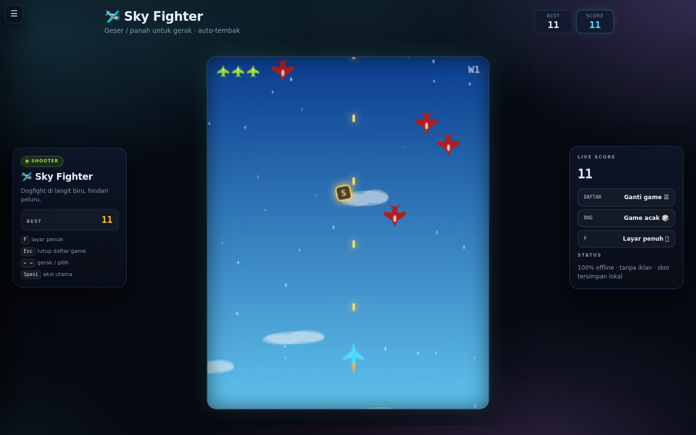

<table>
  <tr>
    <td></td>
    <td>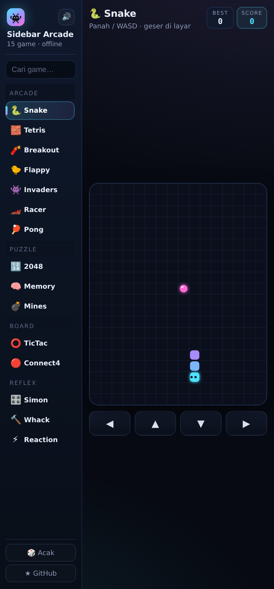</td>
  </tr>
  <tr>
    <td>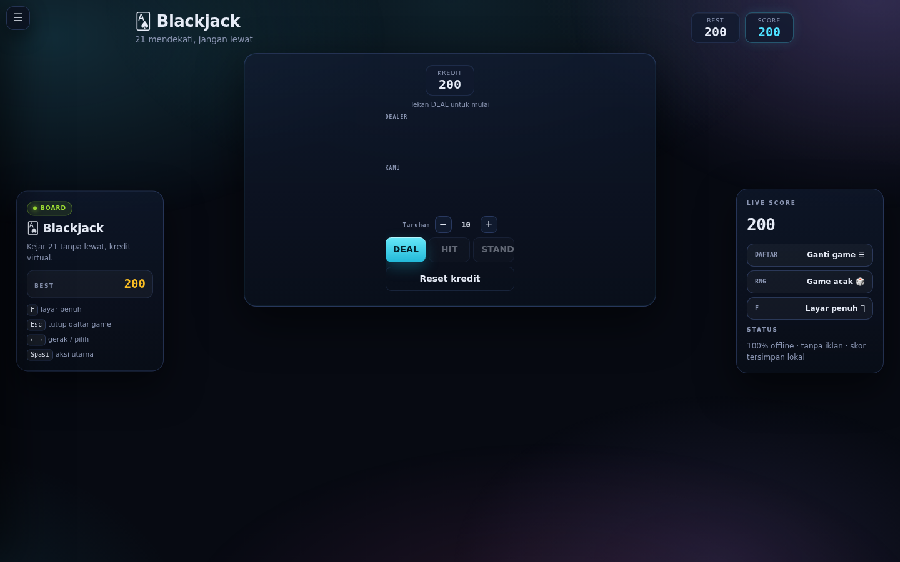</td>
    <td></td>
  </tr>
</table>

## Instalasi (Load unpacked)

1. Download repo ini (Code → Download ZIP) lalu extract, atau:
   ```bash
   git clone https://github.com/aisac-id/sidebar-arcade.git
   ```
2. Buka `chrome://extensions`
3. Nyalakan **Developer mode** (kanan atas).
4. Klik **Load unpacked**, pilih folder `sidebar-arcade`.
5. Klik ikon **Sidebar Arcade** di toolbar → side panel terbuka di kanan.

> Butuh **Chrome 116+** (Side Panel API). Jalan juga di Edge/Brave/Arc versi baru.

### Soal lebar 1/4 layar

Chrome nggak menyediakan API untuk memaksa lebar side panel — lebarnya diatur user. UI extension ini memang **dirancang untuk panel sempit (~320–420 px)**, jadi begitu panel dibuka tinggal **drag garis pemisah panel** sampai kira-kira **1/4 lebar layar** (misal 360 px di monitor 1440 px). Ukurannya mengikuti, nggak ada layout yang pecah dari 320 px sampai panel lebar.

Tip: klik kanan ikon extension → **Open side panel** juga bisa. Mau selalu di kanan? Chrome mengingat posisi terakhir.

## Cara pakai

- **Pilih game** di daftar kiri (vertikal, dikelompokkan per kategori). Di mode layar besar, daftar ada di balik tombol ☰.
- Di mode layar besar: `F` = fullscreen, `Esc` = tutup daftar game.
- **Cari** dengan kotak "Cari game…", atau tekan **🎲 Acak** kalau bingung.
- Skor terbaik tiap game muncul di chip **BEST** dan di bawah nama game pada tab.
- **🔊** untuk mute/unmute. Game terakhir yang dibuka otomatis kebuka lagi saat panel dibuka.
- Game over → tombol **Main lagi** (atau `Enter`/`Spasi` di beberapa game).

## Struktur project

```
sidebar-arcade/
├── manifest.json          # MV3, side_panel + storage
├── background.js          # service worker: buka panel saat ikon diklik
├── sidepanel.html         # shell: sidebar vertikal + area game
├── icons/                 # ikon 16/32/48/128 (+ master 512)
├── brand/                 # logo, wordmark, muka box
├── promo/                 # poster, banner, software box, video promo
├── tools/                 # script pembangun aset brand/promo (Python + PIL)
├── docs/                  # screenshot untuk README
└── src/
    ├── app.js             # routing tab, simpan skor, sound, pencarian
    ├── registry.js        # daftar game (urutan tampil)
    ├── styles.css         # desain panel sempit
    ├── lib/
    │   ├── kit.js         # helper DOM, stage canvas, input, sfx, best score
    │   ├── store.js       # chrome.storage.local + fallback localStorage
    │   └── engines/       # mesin bersama
    │       ├── shmup.js   # shooter vertikal
    │       ├── laner.js   # game 3–4 lajur
    │       ├── bricks.js  # breakout/brick
    │       ├── runner.js  # endless runner
    │       ├── aim.js     # tap target
    │       └── casino.js  # shell & bet row untuk game taruhan
    ├── games/             # 15 game original
    │   ├── snake.js  tetris.js  2048.js  breakout.js
    │   ├── flappy.js invaders.js dodge.js pong.js
    │   ├── memory.js mines.js   tictactoe.js connect4.js
    │   └── simon.js  whack.js   reaction.js
    └── packs/             # 100 game tambahan (data + mount)
        ├── _shared.js     # helper papan/kartu/dadu
        ├── shooters.js    # 12 game pesawat & shooter
        ├── racing.js      # 10 game balap/lari
        ├── bricks.js      # 6 game brick
        ├── runners.js     # 6 game runner
        ├── puzzles1.js    # puzzle & word
        ├── puzzles2.js    # puzzle logika
        ├── board.js       # board, kartu, dadu
        ├── luck.js        # dingdong / slot / roda
        ├── reflex.js      # refleks & aim
        └── skill.js       # olahraga & skill
```

## Menambah game baru

Setiap game adalah satu entri dengan kontrak sederhana. Bisa ditaruh di `src/games/*.js` (satu file) atau sebagai entri di `src/packs/*.js`:

```js
import { createStage, COLORS, sfx } from "../lib/kit.js";

export default {
  id: "gameku",           // unik, dipakai untuk simpan skor
  name: "Game Ku",        // label di tab (pendek, ~10 karakter)
  emoji: "🕹️",
  tag: "Arcade",          // Arcade | Shooter | Racing | Puzzle | Word | Board | Luck | Reflex | Skill
  desc: "Deskripsi singkat.",
  bestMode: "max",        // "max" atau "min" (mis. reaction time)

  mount(ctx) {
    const st = createStage(ctx.root, {
      w: 320, h: 400,
      title: "🕹️ Game Ku",
      subtitle: "Panah untuk gerak",
      best: ctx.best,
    });

    st.loop((dt) => { /* update + gambar tiap frame */ });
    st.onKeyDown((key) => sfx("click"));
    st.onTap(() => {});
    st.onSwipe((dir) => {});

    // saat selesai:
    // st.end({ score: 123, sub: "Skor 123", retry: start });
    // ctx.report(123);  ← simpan rekor

    return { destroy: st.destroy };
  },
};
```

Lalu daftarkan di `src/registry.js`:

```js
import { gameku } from "./packs/gameku.js";
export const GAMES = [/* ... */, gameku];
```

Untuk game berbasis DOM (kartu/papan/slot) pakai `createScreen` — lihat `src/games/memory.js` atau `src/packs/board.js`. `ctx.report(score)` dipanggil sekali saat ronde selesai untuk menyimpan rekor.

## Privasi

Extension ini tidak punya akses ke halaman web, tidak mengirim data ke mana pun, dan tidak memakai analytics. Yang disimpan hanya di `chrome.storage.local` kamu: skor terbaik, game terakhir, dan preferensi suara.

Permission yang diminta:
- `sidePanel` — membuka UI di side panel.
- `storage` — menyimpan skor & preferensi.

## Kontribusi

PR game baru sangat welcome. Aturan mainnya cuma:

1. Satu game = satu entri dengan `id` unik, daftarkan di `registry.js`.
2. Tanpa dependency eksternal, tanpa request jaringan, tanpa `innerHTML` dari input user.
3. Harus enak dimainkan di lebar 320 px dan bisa pakai keyboard **dan** sentuh.
4. Ikuti gaya kode yang ada (vanilla JS, ES modules, komentar seperlunya).

## Lisensi

[MIT](LICENSE) — bebas dipakai, diubah, dan dibagikan.

---

## Brand & Promotion Kit

Aset branding resmi **Sidebar Arcade** — logo, software box, poster, banner, dan materi sosial.
Semua aset berada di folder [`promo/`](promo/) dan bebas dipakai untuk materi promosi proyek ini.

<p align="center">
  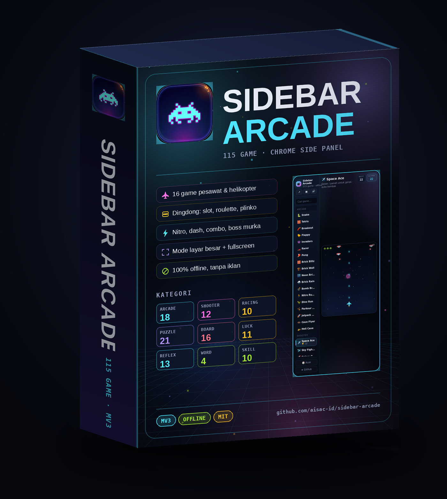
</p>

| Aset | Pratinjau | Ukuran |
|---|---|---|
| Logo | 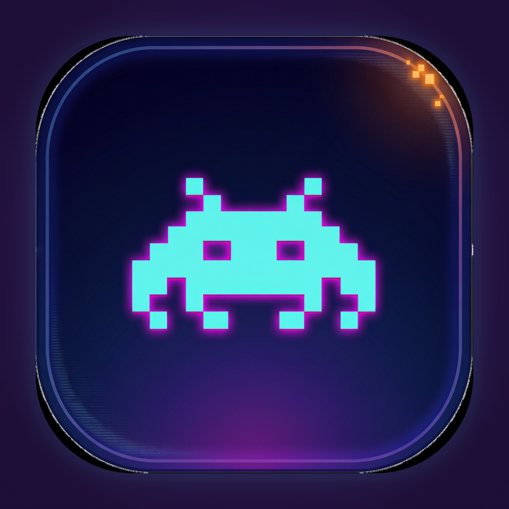 | 1024×1024 |
| Wordmark | 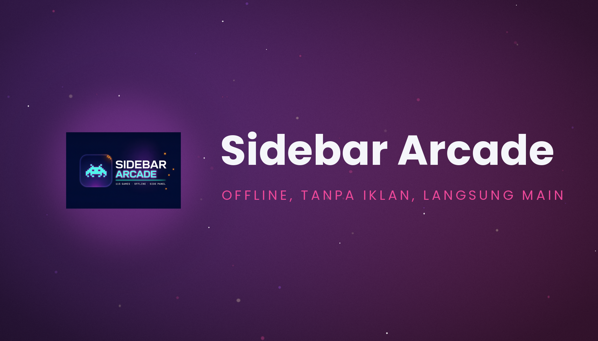 | 1600×500 |
| Software Box |  | 1600×1200 |
| Poster | 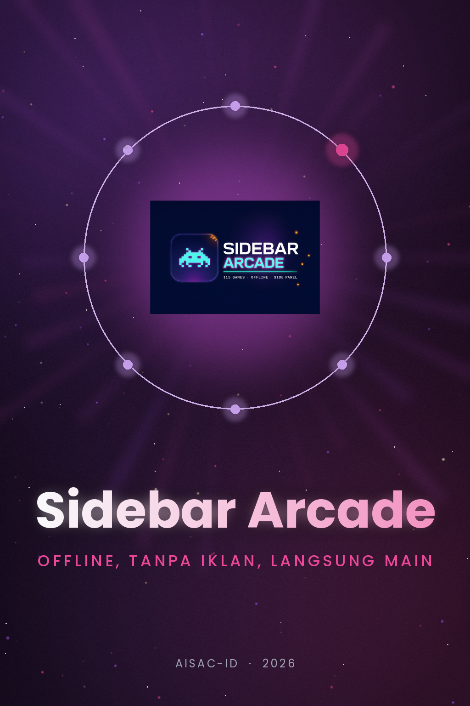 | 1200×1600 |
| Banner |  | 1920×820 |
| Social Preview | 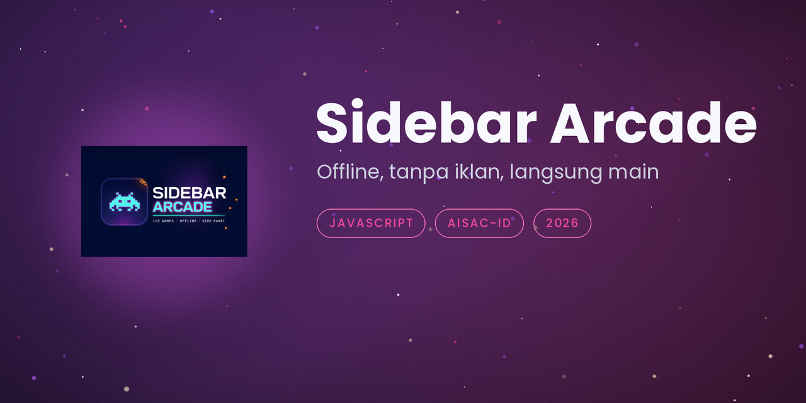 | 1280×640 |
| Feature Showcase | 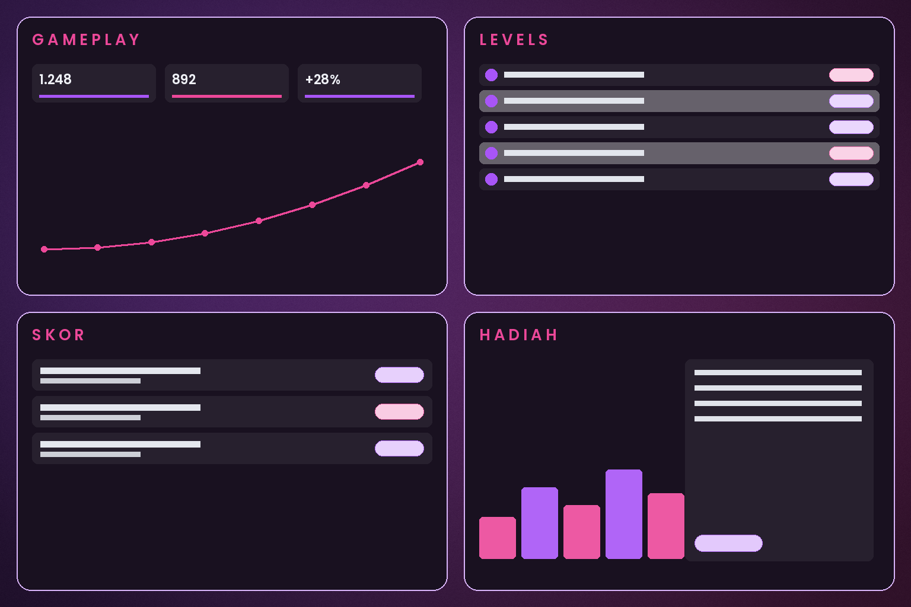 | 1600×1000 |
| Social Square | 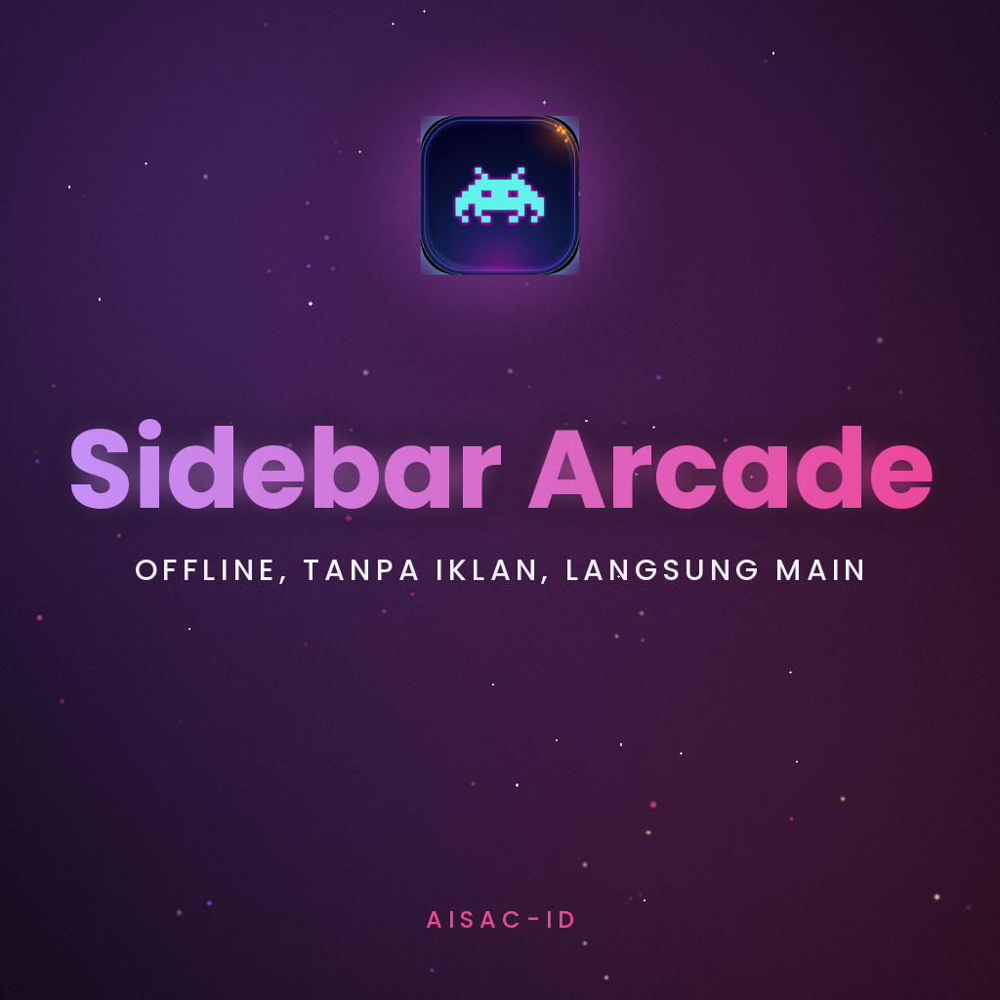 | 1080×1080 |

**Video promosi:** [sidebar-arcade-promo.mp4](promo/sidebar-arcade-promo.mp4)
